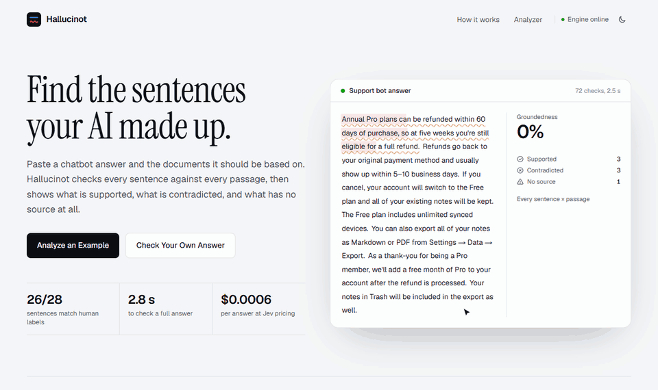

<div align="center">

# Hallucinot

### Catch your AI making things up.

Your support bot just promised a customer a **60-day** refund.<br/>
Your policy says **30**. Hallucinot noticed.

<br/>



<br/>


</div>

## Play it

1. **Pick** an answer: a support bot, a space explainer, an HR assistant, or your own text.
2. **Flag** the sentences you think are made up.
3. **Check.** Highlights sweep in, and you see how you did against Hallucinot.

Then dig in. Click any sentence and a line connects it to the exact passage that backs it 🟩 or contradicts it 🟥. Sentences with no source at all are marked 🟨.

## How it works

Instead of asking an LLM to write a review of an answer, Hallucinot asks hundreds of tiny multiple-choice questions, one for every sentence × passage pair:

> Does this passage **back**, **contradict**, or **say nothing about** “Refunds are open for 60 days”?

A [Jev](https://typesafe.ai)-style decision model answers each one with probabilities, not prose. Plain code does the rest: each sentence keeps its strongest evidence, and anything the model is unsure about goes to a human.

## Does it work?

These are real runs on the built-in examples, scored against hand labels:

| Example | Checks | Time | Cost | Matches labels |
|---|---|---|---|---|
| Support Bot | 72 | 2.5 s | $0.0006 | 9/9 |
| Space Facts | 81 | 2.6 s | $0.0006 | 8/9 |
| HR Policy | 80 | 3.3 s | $0.0006 | 9/10 |

**26 of 28 sentences are right, and the two misses were flagged for human review instead of being stated confidently.**

## Features

| | |
|---|---|
| 🎯 **Spot-the-fake game** | Flag sentences, then score yourself against the checker |
| 🔗 **Evidence lines** | Connect every claim to the passage that proves or disproves it |
| 🎚️ **Trust slider** | Set how sure the model must be, and results re-sort instantly with no new API calls |
| ⌨️ **Keyboard first** | `←` `→` step through sentences, `N` jumps to the next issue, `Ctrl + Enter` checks |
| 📋 **Copy report** | Get a Markdown summary for tickets and pull requests |
| 🌗 **Light and dark** | Theme toggle, accessible marks that don't rely on color alone, and reduced-motion support |

## Run it

```bash
git clone https://github.com/NoumanZahid-85/hallucinot.git && cd hallucinot
npm install
cp .env.example .env.local   # add your key
npm run dev
```

| Engine | `TYPESAFE_BASE_URL` | Cost |
|---|---|---|
| OpenJev on [codiv.ai](https://codiv.ai) | `https://api.codiv.ai` | Free tier |
| Jev by [TypeSafe](https://typesafe.ai) | `https://api.typesafe.ai` | $0.042 per 1M input tokens |

Set `TYPESAFE_API_KEY` too. No key yet? `JEV_ENGINE=mock npm run dev` runs an offline mock for UI work.

**Deploy:** import the repo on [Vercel](https://vercel.com/new), add the two variables, and you're done. The key stays on the server, and rate limits and retries are built in.

## Honest limits

- The probabilities rank options well, but they aren't proven to be calibrated. That's why you set the trust level yourself.
- Math and dates are weak spots, such as checking whether "five weeks" is within 30 days.
- Each passage is judged on its own, so a claim that needs two passages combined can come back as "no source."

<sub>Built on the System One API from [TypeSafe](https://typesafe.ai), served free by [OpenJev](https://github.com/razorback16/openjev). The sample companies are fictional, and the space facts are real (the AI's mistakes are deliberate).</sub>
