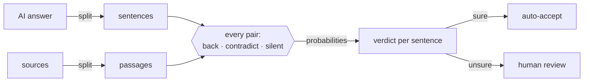

<div align="center">

# Alibi

**Every sentence needs an alibi.**

Your support bot just told a customer they have 60 days to get a refund.<br/>
Your policy says 30. Nobody noticed.

Alibi checks every sentence of an AI answer against the documents it should come from,<br/>
and shows you which ones are backed, which are contradicted, and which were invented.

<br/>


<br/>


</div>

---

## The problem

RAG chatbots answer from your docs, and they still make things up. The usual fixes don't hold up at scale:

- **A person reads every answer against the sources.** This is accurate, but it doesn't scale past a few answers a day.
- **Another LLM grades the answer.** It writes a paragraph about a paragraph. You still don't know *which* sentence is wrong, *which* passage proves it, or how much to trust the grade.

## The idea

Don't ask a model to write a review. Ask it hundreds of tiny multiple-choice questions, and let code decide.

For every sentence × passage pair, Alibi asks one question:

> Does this passage **back**, **contradict**, or **say nothing about** “Refunds are open for 60 days”?

The engine ([Jev](https://typesafe.ai)-style typed decisions) returns a probability for each option instead of prose. That makes everything else plain code: each sentence keeps its strongest source, a contradiction beats weak support, and anything the engine is unsure about goes to a human.



## Does it work?

These are real engine runs on the three built-in examples, scored against hand labels:

| Example | Sentences × passages | Questions | Time | Tokens | Cost at Jev price | Matches labels |
|---|---|---|---|---|---|---|
| Support bot | 9 × 7 | 72 | 2.5 s | 13.8k | $0.0006 | 9/9 |
| Science explainer | 9 × 8 | 81 | 2.6 s | 14.4k | $0.0006 | 8/9 |
| HR assistant | 10 × 7 | 80 | 3.3 s | 15.0k | $0.0006 | 9/10 |

**26 of 28 sentences match. Both misses fell below the review threshold**, so they went to a person instead of shipping as confident mistakes. At list price, a dollar audits about 1,600 answers.

## What you can do with it

- **Read the marks.** Green highlights are backed. Pink with a wavy underline is contradicted. Yellow with a dashed underline has no source. Every verdict has its own shape, so you can read it without relying on color.
- **Follow the evidence.** Click any sentence and lines connect it to the exact passages that back or refute it.
- **Jump between problems.** Use **Next issue**, or step through sentences with the `←` `→` keys.
- **Set your own bar for trust.** Drag the review threshold and verdicts re-sort instantly, with no new API calls.
- **See every check.** A grid shows every sentence × passage question the engine answered.
- **Bring your own text.** Paste any answer and its sources, then press `Ctrl + Enter`.
- **Copy a Markdown report** to share in a ticket or pull request.

## Run it

```bash
git clone https://github.com/NoumanZahid-85/alibi.git && cd alibi
npm install
cp .env.example .env.local   # add a key, see below
npm run dev                  # http://localhost:3000
```

No key? `JEV_ENGINE=mock npm run dev` runs an offline mock so you can work on the UI. It is clearly labeled as not Jev.

### Pick an engine

Alibi works with any endpoint that speaks TypeSafe's System One API. Switching engines only means changing environment variables.

| Engine | `TYPESAFE_BASE_URL` | `TYPESAFE_MODEL` | Cost |
|---|---|---|---|
| OpenJev on [codiv.ai](https://codiv.ai) | `https://api.codiv.ai` | `jev-latest` | Free tier, 100M tokens |
| Jev by [TypeSafe](https://typesafe.ai) | `https://api.typesafe.ai` | `jev-latest` | $0.042 per 1M input tokens |
| Jev via Vercel AI Gateway | `https://ai-gateway.vercel.sh/typesafe` | `typesafe-ai/jev` | AI Gateway credits |

Set `TYPESAFE_API_KEY` for whichever engine you pick. It is only read on the server.

### Deploy to Vercel

1. Import the repo at [vercel.com/new](https://vercel.com/new).
2. Add `TYPESAFE_BASE_URL`, `TYPESAFE_API_KEY` and `TYPESAFE_MODEL` as environment variables.
3. Deploy.

The page is prerendered, and only `/api/check` runs as a function. A per-IP rate limit, input caps and retries are built in. If the engine is down, the saved examples keep working.

To refresh the saved examples after changing the prompts, run `npm run dev`, then `npm run seed`. The seed script reports agreement with the hand labels.

## Under the hood

```
src/lib/engine.ts      fan-out: one call per passage, every sentence a typed question
src/lib/verdict.ts     probabilities → verdict, confidence, review routing
src/lib/split.ts       sentences and passages (shared by browser and server)
src/app/api/check      validation, rate limit, error handling
src/components         hero, composer, verdict bar, evidence board, check grid
src/data               three examples with hand labels and saved real runs
```

Two lessons from testing are now in the code:

- **"Judge only from the passage."** Without that instruction, the engine marked "The Eiffel Tower is in Berlin" as contradicted by a passage that only gave the completion date. It was using world knowledge, not the source.
- **Strong evidence overrules the filler filter.** A sentence a source backs or refutes with high confidence can't be "just a greeting."

## Honest limits

- The probabilities rank options well, but nobody has proven they are calibrated. That's why the threshold is a slider you control.
- Arithmetic and dates are weak spots. "Five weeks is within 30 days" needs math, not reading.
- Each passage is judged on its own. A claim that needs two passages combined can come back as "no source."

## Credits

[TypeSafe](https://typesafe.ai) for Jev and the System One API, which shaped the three-way verdict through their [citation-check cookbook](https://docs.typesafe.ai/cookbooks/citation_check). [OpenJev](https://github.com/razorback16/openjev) is an independent open-source server for the same API. Lumen Notes and Kestrel Analytics are made-up companies. The telescope facts are real, and the AI answer about them contains deliberate mistakes.
