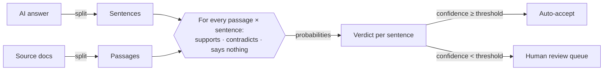

<div align="center">

# 🧾 Receipts

### Every sentence an AI writes should come with a receipt.

A hallucination heatmap for RAG answers. Paste an AI answer and its sources, and Receipts checks **every sentence against every source passage in parallel**. It shows which claims are backed, which are contradicted, and which are made up, in about two seconds.


</div>

---

## The problem

RAG chatbots answer from your documents, yet they still invent refund windows, misquote policies and confidently state the opposite of the source. Teams catch these errors in one of two ways:

- **A human reads the answer against the docs.** This is accurate, but it doesn't scale past a few answers a day.
- **Another LLM grades the answer.** A judge model writes a paragraph about the paragraph. It is slow and costly at volume, and its verdict comes back as text you have to parse and trust.

Neither tells you *which sentence* is wrong, *which passage* proves it, or *how sure* the check is.

## The approach

Receipts treats fact-checking as many small, typed decisions instead of one big essay:



1. **Split.** The answer becomes sentences and the sources become passages.
2. **Ask.** One API call per passage. The passage is the *state*, and every sentence is an independent typed `choice` question with three options: `supports`, `contradicts`, `says_nothing`. A separate `noul` (yes/no) call filters out greetings and filler.
3. **Decide in code.** Each sentence keeps its strongest receipt. Contradictions beat weak support. Anything below the confidence threshold goes to a human queue. Moving the slider re-routes everything instantly in the browser with **zero new API calls**, because the engine returned probabilities, not prose.

This is the [System One](https://docs.typesafe.ai/concepts/system-one) pattern from TypeSafe's Jev: the model makes calibrated judgments, and plain code owns the logic.

## Results

Measured on the three built-in demos against hand labels. These are real engine runs, saved in [`src/data/demo-results.json`](src/data/demo-results.json):

| Demo | Sentences × passages | Questions | Parallel calls | Wall time | Input tokens | Cost at Jev price | Agrees with labels |
|---|---|---|---|---|---|---|---|
| Support bot | 9 × 7 | 72 | 8 | 2.15 s | 12.1k | $0.00051 | 9/9 |
| Science explainer | 9 × 8 | 81 | 9 | 2.56 s | 12.4k | $0.00052 | 9/9 |
| HR assistant | 10 × 7 | 80 | 8 | 2.28 s | 13.1k | $0.00055 | 9/10 |

**27/28 sentences match the hand labels.** The one miss ("you can split the leave into as many blocks as you like") is a subtle quantifier contradiction. Each check costs about **$0.0005** at Jev's list price, so **$1 covers about 2,000 full answer audits**.

Engine: OpenJev v0.1 via codiv.ai. Runs can vary slightly from one run to the next.

## Features

- **Evidence board.** Click any sentence to draw lines to the passages that back it (green) or refute it (red).
- **Receipt summary.** Groundedness score, verdict counts, questions asked, latency, tokens and cost.
- **Confidence routing.** An auto-accept slider and a live human review queue.
- **Evidence matrix.** The full sentence × passage heatmap, where every cell is one typed question.
- **Built-in eval.** Demos carry hand labels, and disagreements are marked `≠` on the board.
- **Bring your own text.** Paste any answer and its sources (`# Title` starts a document).
- **Production guards.** Server-side key, per-IP rate limit, input caps, retries with backoff on `429`/`529`, and saved demos that keep working if the engine is busy.
- **Light and dark themes**, a mobile layout, keyboard-accessible sentences, and reduced-motion support.

## Quick start

```bash
git clone <your-repo-url> receipts && cd receipts
npm install
cp .env.example .env.local     # add your key
npm run dev                    # http://localhost:3000
```

No key yet? Run `JEV_ENGINE=mock npm run dev` for an offline word-overlap mock. The app labels it as not Jev. Use it for UI work only.

### Refresh the saved demo runs

```bash
npm run dev     # terminal 1
npm run seed    # terminal 2: runs every demo live, saves results, prints label agreement
```

## Configuration

Receipts talks to any endpoint that speaks TypeSafe's System One API (`POST /v1/systemone`). Switching engines only means changing environment variables:

| Engine | `TYPESAFE_BASE_URL` | `TYPESAFE_MODEL` | Notes |
|---|---|---|---|
| **OpenJev** on codiv.ai | `https://api.codiv.ai` | `jev-latest` | Free tier: 100M input tokens, no card |
| **Jev** by TypeSafe | `https://api.typesafe.ai` | `jev-latest` | $0.042 per 1M input tokens |
| **Jev** via Vercel AI Gateway | `https://ai-gateway.vercel.sh/typesafe` | `typesafe-ai/jev` | Uses an AI Gateway key |

| Variable | Required | Description |
|---|---|---|
| `TYPESAFE_API_KEY` | yes | Engine API key. It is only read on the server. |
| `TYPESAFE_BASE_URL` | no | Defaults to `https://api.typesafe.ai` |
| `TYPESAFE_MODEL` | no | Defaults to `jev-latest` |
| `RATE_LIMIT_PER_10_MIN` | no | Live checks per visitor IP (default `8`) |
| `JEV_ENGINE` | no | Set to `mock` for offline UI development |

## Deploy to Vercel

1. Push the repo to GitHub and import it at [vercel.com/new](https://vercel.com/new). Next.js is detected automatically.
2. In **Settings → Environment Variables**, add `TYPESAFE_BASE_URL`, `TYPESAFE_API_KEY` and `TYPESAFE_MODEL`.
3. Deploy. The homepage is statically prerendered, and only `/api/check` runs as a serverless function (60 s max duration).

If you change environment variables later, redeploy so the engine badge updates.

## Project structure

```
src/
├── app/
│   ├── api/check/route.ts    POST endpoint: validation, rate limit, error mapping
│   ├── page.tsx              loads demos + saved runs
│   └── opengraph-image.tsx   social preview card
├── components/
│   ├── ReceiptsApp.tsx       shell, demo tabs, input editor, live runs
│   └── Results.tsx           receipt, review queue, evidence board, matrix
├── lib/
│   ├── engine.ts             System One client: fan-out, retries, mock engine
│   ├── split.ts              sentence + passage splitting (shared client/server)
│   └── verdict.ts            probabilities → verdict, confidence, review routing
└── data/
    ├── demos.ts              three demo cases with hand labels
    └── demo-results.json     saved real engine runs
scripts/seed-demos.mjs        regenerates demo-results.json and reports agreement
```

## Limitations

- **Calibration is not guaranteed.** OpenJev's probabilities come from a diffusion model's single denoising step. They rank options well, but "0.8" is not proven to mean 80%. That is why the threshold is a slider and not a constant.
- **Arithmetic and dates are weak spots** for this model class. A claim like "five weeks is within 30 days" needs math, not reading.
- **Passage-level judging.** A claim that needs two passages combined can come back as "no receipt."
- The per-IP rate limit is best effort, because serverless instances don't share memory. For a hard quota, put it behind a shared store such as Upstash or Vercel KV.

## Acknowledgements

- [TypeSafe](https://typesafe.ai) for Jev and the System One API design, and their [citation-check cookbook](https://docs.typesafe.ai/cookbooks/citation_check), which inspired the three-way verdict.
- [OpenJev](https://github.com/razorback16/openjev), an independent open-source server that implements the same API. It is not affiliated with TypeSafe.
- Lumen Notes and Kestrel Analytics are fictional sample companies. The James Webb Space Telescope notes are factual, and the AI answer about it contains deliberate errors.
